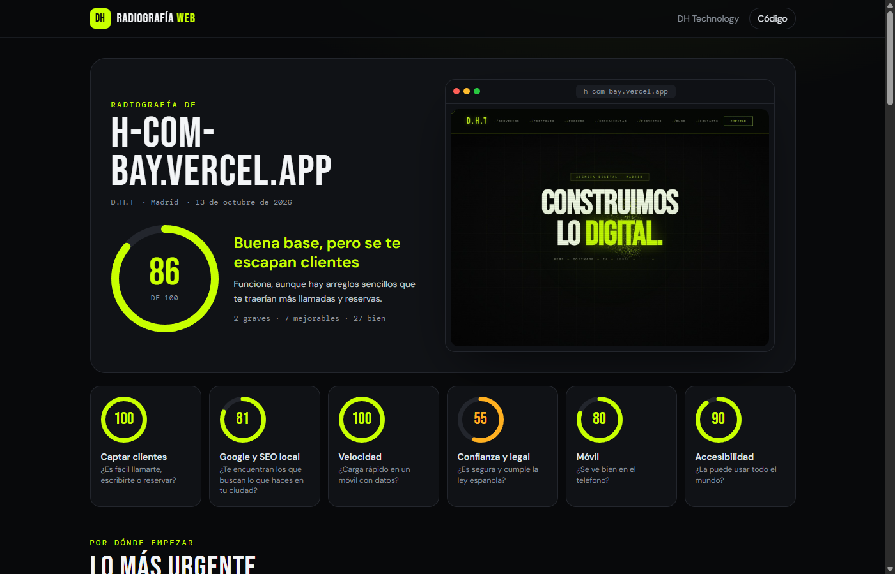
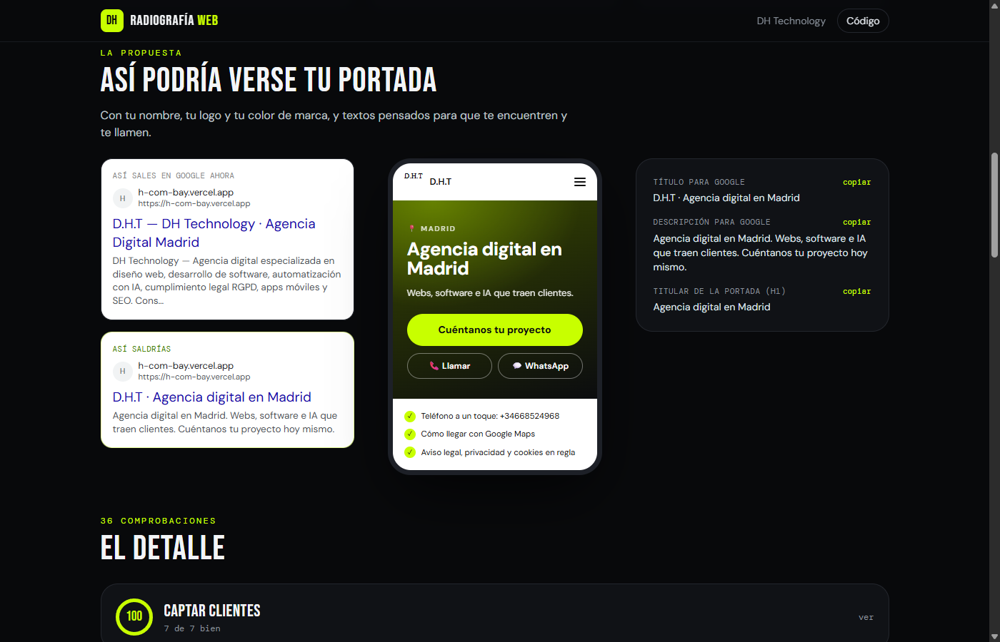

# Radiografía web

**¿Tu web te trae clientes o te los quita?** Escribe la dirección de la web de un negocio y en unos segundos tienes un informe en castellano llano: qué está espantando a los clientes, por qué importa y cómo se arregla. Incluye una propuesta de cómo podría ser su portada.

**Pruébala: [dht-radiografia.vercel.app](https://dht-radiografia.vercel.app)**



## Qué revisa

Medio centenar de comprobaciones en seis categorías (las que aplican a cada web), ponderadas por lo que más pesa en un negocio local:

| Categoría | Qué mira |
|---|---|
| **Captar clientes** (25 %) | Teléfono visible y que se pulsa (`tel:`), WhatsApp, botones de reservar o pedir cita, formulario, dirección y mapa, redes |
| **Google y SEO local** (20 %) | Título y descripción (longitud y ciudad), un único H1, ficha de negocio `schema.org`, Open Graph para WhatsApp, texto suficiente, sitemap, `noindex` y robots.txt |
| **Velocidad** (20 %) | Respuesta del servidor, peso y formato real de las imágenes (se pesan una a una), scripts que bloquean, servicios externos, compresión y redirecciones |
| **Confianza y legal** (15 %) | HTTPS, redirección http → https, días que le quedan al certificado, contenido mixto, **aviso legal (LSSI)**, **privacidad (RGPD)**, **cookies con consentimiento** si hay rastreadores, año del pie y enlaces rotos |
| **Móvil** (10 %) | Viewport, imágenes por tamaño (`srcset`) y saltos al cargar |
| **Accesibilidad** (10 %) | Textos alternativos, zoom permitido, botones y campos con nombre, idioma |

Cada fallo explica **el impacto en clientes**, no en jerga, y **cómo arreglarlo**. Después vienen «lo más urgente», la vista previa de cómo sale en Google ahora y cómo saldría, y una maqueta de la portada en el móvil con el nombre, el logo y el color de marca del negocio.



## Cómo funciona

- **Sin navegador en el servidor.** Descarga el HTML como lo haría un móvil y lo analiza sin ejecutar JavaScript (lo mismo que ve Google en la primera pasada). Las imágenes se pesan con peticiones `HEAD` en paralelo. Casi todo es espera de red, así que apenas gasta CPU.
- **Seguro ante SSRF.** La dirección la escribe cualquiera: se resuelve el dominio y se rechazan IPs privadas, locales y reservadas en cada salto de redirección (que se siguen a mano), con límite de tiempo y de tamaño.
- **Progreso en vivo.** `/api/analizar` responde en NDJSON: un mensaje por paso y el informe al final.
- **Honesto con las webs hechas con JavaScript.** Si el HTML llega vacío (React, Vue…), lo dice y no suspende lo que no puede ver.
- **Detección de tipo de negocio, nombre, ciudad, colores y CMS** a partir del JSON-LD, el texto, los códigos postales y el CSS (sin confundir la paleta por defecto de WordPress ni las entidades HTML con colores de marca).
- **Opcional, Claude Haiku 5.5** (`ANTHROPIC_API_KEY`): lee los textos de la portada y propone título, descripción, titular y llamada a la acción con salida estructurada, más una «primera impresión». Sin clave, las propuestas salen de plantillas por tipo de negocio.
- **Opcional, Google Lighthouse** (`PSI_API_KEY`, gratuita): notas oficiales, Core Web Vitals y datos reales de usuarios de Chrome. Lighthouse corre en los servidores de Google.
- **Captura** de la web con el servicio público mShots de WordPress.com.
- **Informe en PDF** con estilos de impresión, y enlace para compartir (`?url=…`).

## Ejecutarlo

```bash
npm install
npm run dev      # la función /api/analizar también funciona en local
npm test         # 20 pruebas: red (SSRF, robots.txt), extracción, reglas, propuestas y análisis completo con red simulada
npm run build
```

## Estructura

```
api/analizar.ts            Análisis en streaming (NDJSON), con límite por IP y caché de 10 min
api/textos.ts              Propuesta de textos con Claude (opcional)
api/pagespeed.ts           Lighthouse de Google (opcional)
api/_lib/red.ts            Descargas seguras: SSRF, redirecciones, tamaño, certificado, robots.txt
api/_lib/extraer.ts        Lee el HTML: textos, contacto, legal, imágenes, scripts, marca, CMS
api/_lib/reglas.ts         Las comprobaciones y las notas
api/_lib/textos.ts         Tipo de negocio y propuestas de textos
src/                       La web (React + Tailwind)
```

---

Hecho por [DH Technology](https://h-com-bay.vercel.app). Licencia MIT.
